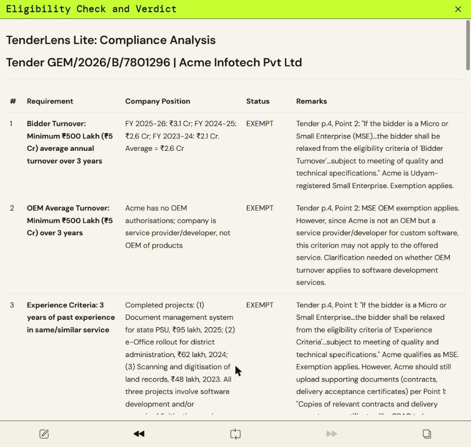
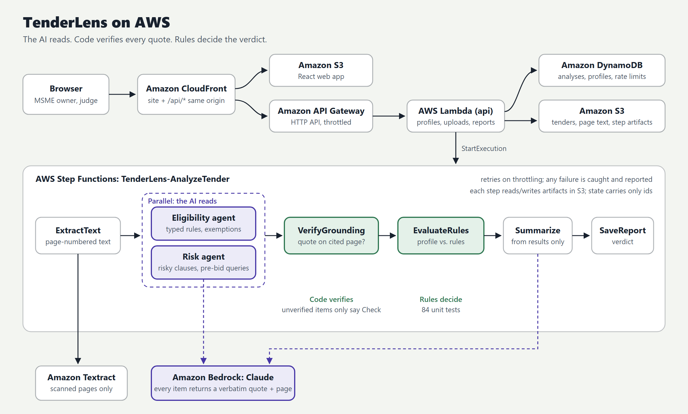

# Builder Center project post: TenderLens

> Paste everything below the line into your Builder Center project. Replace `[[GITHUB_URL]]` (and
> `[[VIDEO_URL]]` if you record one). Upload `architecture.png`, `proof/partyrock-verdict.jpg`,
> `proof/partyrock-app.jpg` and `proof/partyrock-build.gif`. Tags: **#commercial-potential** and **#startups**.

---

## TenderLens: know if your MSME can bid on a government tender before you read 40 pages of it

**Live app (runs on AWS PartyRock / Amazon Bedrock):** https://partyrock.aws/u/soviet1991/OCmIbF0Qg/TenderLens-Lite%253A-Government-Bid-Eligibility-Checker
**Code:** [[GITHUB_URL]]  ·  **Category:** Commercial potential  ·  **Lane:** Startups

### The problem

The Indian government buys a huge share of its goods and services through the Government e-Marketplace
(GeM) and the Central Public Procurement Portal (CPPP), and the rules deliberately favour micro and small
enterprises (MSEs). Many tenders waive the bid security (EMD) for MSEs and relax the turnover and
experience criteria for MSEs and startups.

But every opportunity arrives as a 10 to 200 page PDF. The eligibility rules sit in bilingual tables,
annexures and boilerplate, and the exemption that changes everything is one "Yes" in a long list of
fields. A small firm owner either spends hours reading each bid or skips tenders they could have won.

I co-founded **Valivo.ai**, an AI automation company in Gurugram that builds agentic systems for business
workflows. Long, messy procurement documents are exactly what we automate, and TenderLens is the first
vertical we're building.

### What it does

Upload a tender PDF and describe your company (a demo company is pre-filled). TenderLens returns:

- **Every bidder requirement and MSE/startup exemption**, each with the tender's **exact words and page number**.
- **A requirement-by-requirement check** against your company (Met, Not met, Exempt, Check), with the
  numbers behind each decision, ending in a **one-line verdict**.
- **Risky clauses** (penalties, payment terms, performance security, liability) explained for a business
  owner, each with a **ready-to-send pre-bid query**.
- **A document checklist** of only what this tender asks for.
- **A chatbot** that answers questions about the tender by quoting it.

**Real run, live GeM bid GEM/2026/B/7801296 (Indian Air Force, custom document-digitisation software),
checked for a demo small IT company:**
- Key facts pulled correctly: bid end 23-10-2026 16:00, EMD ₹43.8 lakh.
- Required average turnover ₹5 Cr vs. the company's ₹2.6 Cr → **Exempt**, quoting the tender: *"If the
  bidder is a Micro or Small Enterprise (MSE)… the bidder shall be relaxed from the eligibility criteria of
  'Bidder Turnover'"* (p. 4).
- **Verdict: Eligible with caution.** It caught a requirement a first read easily misses: service-centre
  presence near the consignee in Bangalore, while the company is in Haryana.

### How it stays trustworthy

A language model is good at finding requirements in a long PDF and bad at guaranteeing it didn't invent
one. For a bid/no-bid decision, an invented requirement is worse than none. Every step is instructed to:

- quote the tender verbatim with a page number for every item, and never add anything not written in it;
- apply an MSE or startup exemption **only when the tender itself grants it** and the company qualifies;
- answer **"Check"** whenever it can't be sure;
- run with **web search disabled**, so the tender is the only source.

The full engineered version in the repository goes further: **code** verifies every quote against the
cited page, and a **deterministic rule engine with 84 unit tests** makes the eligibility decision, so the
model never decides "eligible" at all.

### Built on AWS

**Live today: AWS PartyRock**, AWS's app builder on **Amazon Bedrock**. Each step is a separate AI widget
running **Claude Sonnet 5 on Bedrock** (`bedrock-anthropic.claude-5-0-sonnet-v1-0`), chained together:
Tender PDF → Requirements and exemptions → Company profile → Can you bid? → Risky clauses and pre-bid
queries → Documents to prepare, plus a chatbot.

**Production architecture, in the repo and ready to deploy** with one CDK command:

- **AWS Step Functions** pipeline: ExtractText → Parallel(EligibilityAgent, RiskAgent) → VerifyGrounding →
  EvaluateRules → Summarize → SaveReport, with per-step retries and failure handling.
- **Amazon Bedrock** (Claude, Messages API) with tool-based structured extraction and Pydantic validation.
- **AWS Lambda** (Python 3.12), **Amazon S3**, **Amazon DynamoDB**, **Amazon Textract**, **Amazon API Gateway**,
  **Amazon CloudFront**, all defined in one **AWS CDK** stack.
- A React web app with a stamped verdict, page-cited requirements and copyable pre-bid queries.

*Why two versions:* the full stack needs an AWS account, and mine isn't fully activated yet because card
verification is pending. Rather than miss the deadline, I shipped the same product logic on PartyRock,
which runs on AWS with no account required, and kept the production stack ready to deploy.

### How a coding agent helped me ship

I built TenderLens with **Claude Code** as a full engineering partner:

- **Product discovery.** It read my CV, pitched three directions, and when I asked to combine two of them it
  proposed the tender copilot: tenders are eligibility rules and contract terms in one PDF. It wrote a
  design spec before any code.
- **Test-first core.** It built the decision engine test-first (84 tests). A failing test caught a real
  page-boundary bug that could have "verified" a quote from the wrong page.
- **Real data, real problems.** It pulled live bids from GeM's public search and found that the Hindi half of
  GeM's bilingual labels extracts as garbled glyph pairs, then wrote a tested cleaner.
- **Reading the docs instead of guessing.** It checked the live Bedrock documentation, found that structured
  outputs aren't available on the Bedrock Messages endpoint and that forced tool choice is rejected by
  current models, and switched to a submit-tool pattern with validation and a repair round.
- **Getting unstuck.** It installed the AWS CLI without admin rights. When the Python CDK package stalled on
  PyPI, it measured download speeds and ported the stack to TypeScript CDK, which synthesized cleanly.
- **Building the live app on AWS.** Through **Claude in Chrome**, the agent built the PartyRock app itself:
  generated the flow, hardened every prompt with the grounding rules, switched every step to Claude Sonnet 5
  on Bedrock, turned off web search, pre-filled a demo company, ran it on the live Air Force bid, and
  shared it. The whole session was recorded (below).

### Proof of the coding agent working on AWS

- **Recording of the agent building the live app on AWS PartyRock:** `partyrock-build.gif` (attached).
- **The live app** with a real run: `partyrock-app.jpg` and `partyrock-verdict.jpg` (attached).
- **Full development history** in the repository: every commit carries a `Co-Authored-By: Claude`
  trailer and a link to the Claude Code session.

### Try it

1. Open the live app link and sign in to PartyRock (free, no card).
2. Upload a GeM or CPPP bid PDF (sample bids are in the repo under `data/samples/`).
3. Keep the pre-filled demo company or describe your own, then press **Play**.
4. Open **Can you bid?** for the verdict table, and **Risky clauses** for pre-bid queries you can copy.

### Where this goes next (Startups lane)

- **Who pays:** MSMEs that bid regularly on GeM/CPPP, and the consultants and CA firms who prepare bids for
  them. That's a recurring, per-tender job with a clear time saving.
- **Next 90 days:** deploy the production stack, daily alerts for new GeM bids that match a profile, Hindi
  output, and a document locker that pre-fills the checklist.
- **Moat:** grounded, typed-rule checking generalises to any compliance-heavy document (state portals, PSU
  tenders, scheme applications), which is Valivo.ai's core competence.

*TenderLens is a decision aid, not legal advice. Always confirm requirements against the tender.*
